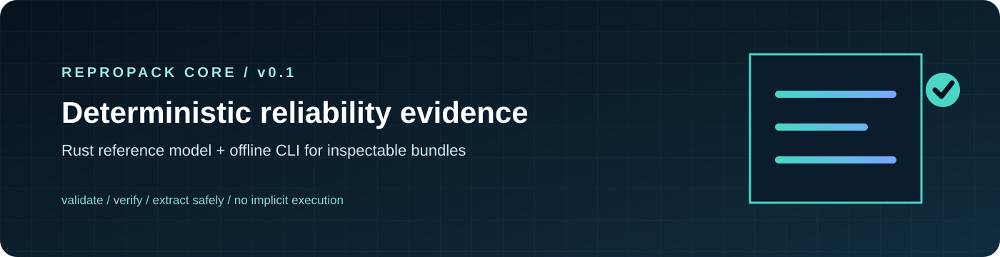
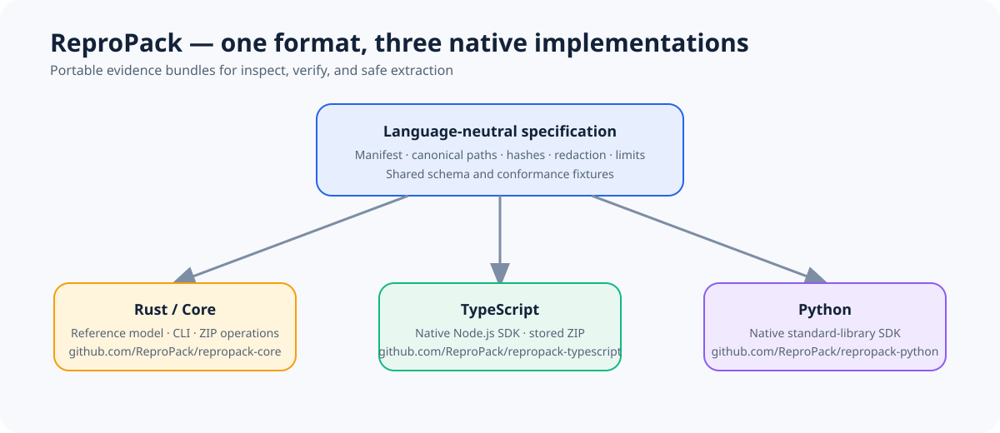

# ReproPack Core

<p align="center"></p>

<p align="center">
  <a href="https://github.com/ReproPack/repropack-core/actions/workflows/ci.yml"></a>
  <a href="https://img.shields.io/badge/runtime-Rust%20%2B%20CLI-2f6f9f"></a>
  <a href="LICENSE"></a>
  <a href="https://img.shields.io/badge/status-v0.1.1%20released-2ea44f"></a>
  <a href="docs/SPECIFICATION.md"></a>
</p>

ReproPack Core defines a small, deterministic evidence-bundle format for software failures and development problems. It provides the language-neutral specification, canonical fixtures, Rust reference implementation, and offline CLI for inspectable reports.

## Repository role

This is the coordination and reference repository. It owns the [normative specification](docs/SPECIFICATION.md), schema, shared [conformance fixtures](docs/CONFORMANCE.md), Rust model, bundle operations, CLI, and security/release/contributor documentation.

The format is transport, not execution. Bundles are not replay recipes, do not reconstruct environments, and are never executed by the CLI.

## Architecture

<p align="center"></p>

The Core specification is consumed independently by [TypeScript](https://github.com/ReproPack/repropack-typescript) and [Python](https://github.com/ReproPack/repropack-python). The implementations do not import or invoke Rust.

## Quickstart

Install Rust, then run the real minimal workflow from this repository:

```bash
cargo run -- capture examples/minimal/manifest.json target/minimal.rpk \
  evidence/message.txt=examples/minimal/evidence/message.txt
cargo run -- inspect target/minimal.rpk
cargo run -- validate target/minimal.rpk
cargo run -- verify target/minimal.rpk
cargo run -- extract target/minimal.rpk target/minimal-extracted
```

See the full [tutorial](docs/TUTORIAL.md), [troubleshooting guide](docs/TROUBLESHOOTING.md), and [architecture notes](docs/ARCHITECTURE.md).

## Documentation and status

- [Project overview](docs/PROJECT_OVERVIEW.md) — scope and repository map.
- [Specification](docs/SPECIFICATION.md) — normative format and semantics.
- [Conformance](docs/CONFORMANCE.md) — shared fixtures and expected behavior.
- [Security](SECURITY.md) — threat model, limits, and reporting guidance.
- [Roadmap](ROADMAP.md) — evidence-based phase status.
- [Release checklist](RELEASE_CHECKLIST.md) — publication gates and known blockers.
- [CI integration example](docs/CI_INTEGRATION.md) — optional safe failure-evidence workflow.

## Current status

Phases 0–14 are complete and v0.1.1 is released on GitHub. PyPI and npm publication are recorded as verified; crates.io publication remains pending. Post-release integrations remain separately scoped.

## Related repositories

| Repository | Role | Start here |
| --- | --- | --- |
| **repropack-core** | Specification, schema, fixtures, Rust reference model, and CLI | [Architecture](docs/ARCHITECTURE.md) |
| **repropack-typescript** | Native Node.js SDK and adapter | [TypeScript](https://github.com/ReproPack/repropack-typescript) |
| **repropack-python** | Native Python SDK and adapter | [Python](https://github.com/ReproPack/repropack-python) |

## Project links

[License](LICENSE) · [Contributing](CONTRIBUTING.md) · [Security](SECURITY.md) · [Code of Conduct](CODE_OF_CONDUCT.md) · [Changelog](CHANGELOG.md) · [Support](SUPPORT.md)
