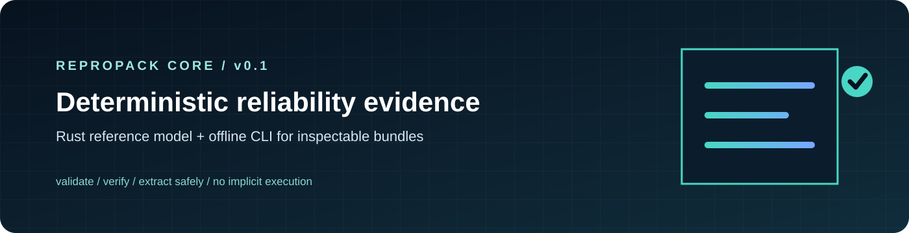
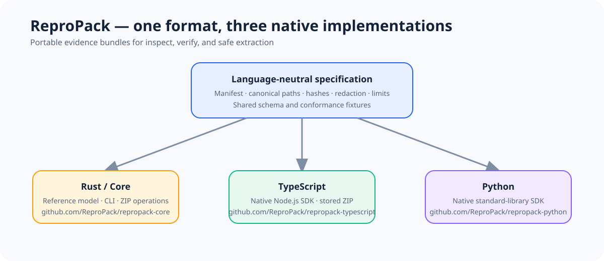

# ReproPack Core

<p align="center"></p>

<p align="center">
  <a href="https://github.com/ReproPack/repropack-core/actions/workflows/ci.yml"></a>
  <a href="https://img.shields.io/badge/runtime-Rust%20%2B%20CLI-2f6f9f"></a>
  <a href="LICENSE"></a>
  <a href="https://img.shields.io/badge/status-v0.1.1%20released-2ea44f"></a>
  <a href="docs/SPECIFICATION.md"></a>
</p>

ReproPack Core defines a small, deterministic evidence-bundle format for software failures and development problems. It provides the language-neutral specification, canonical fixtures, Rust reference implementation, and offline CLI for inspectable reports.

## Repository role

This is the coordination and reference repository. It owns the [normative specification](docs/SPECIFICATION.md), schema, shared [conformance fixtures](docs/CONFORMANCE.md), Rust model, bundle operations, CLI, and security/release/contributor documentation.

The format is transport, not execution. Bundles are not replay recipes, do not reconstruct environments, and are never executed by the CLI.

## What ReproPack captures—and what it does not

ReproPack captures explicitly selected failure evidence: a manifest, provenance, bounded evidence bytes, integrity digests, limits, and redaction metadata. It is intended for maintainers and bug reporters who need a portable artifact that can be inspected by another tool or language implementation.

It does not capture an entire workspace by default, infer a complete dependency graph, guarantee that secrets were removed, reconstruct a runtime environment, provide a sandbox, or replay the failure. Any integration must select its inputs explicitly and review the resulting bundle before sharing it.

## Interoperability evidence

The shared semantic catalog and recorded Phase 8 workflow exercise all 12 directed producer/consumer paths across Rust, TypeScript, and Python for the minimal and redacted fixtures. The comparison covers manifest meaning, evidence bytes, sizes, hashes, redaction state, and expected failure categories. See the [conformance guide](docs/CONFORMANCE.md) for the exact scope and limitations; this evidence does not certify arbitrary future implementations or every possible archive input.

## Sharing and security checklist

Before publishing a bundle, review selected paths and provenance, remove or explicitly redact credentials and personal data, verify the bundle, and keep retention bounded. Treat manifests and evidence as untrusted input. Secret detection is advisory rather than complete, and bundle contents must never be executed as part of inspection or extraction.

## Architecture

<p align="center"></p>

The Core specification is consumed independently by [TypeScript](https://github.com/ReproPack/repropack-typescript) and [Python](https://github.com/ReproPack/repropack-python). The implementations do not import or invoke Rust.

## Quickstart

Install Rust, then run the real minimal workflow from this repository:

```bash
cargo run -- capture examples/minimal/manifest.json target/minimal.rpk \
  evidence/message.txt=examples/minimal/evidence/message.txt
cargo run -- inspect target/minimal.rpk
cargo run -- validate target/minimal.rpk
cargo run -- verify target/minimal.rpk
cargo run -- extract target/minimal.rpk target/minimal-extracted
```

See the full [tutorial](docs/TUTORIAL.md), [troubleshooting guide](docs/TROUBLESHOOTING.md), and [architecture notes](docs/ARCHITECTURE.md).

## Documentation and status

- [Project overview](docs/PROJECT_OVERVIEW.md) — scope and repository map.
- [Specification](docs/SPECIFICATION.md) — normative format and semantics.
- [Conformance](docs/CONFORMANCE.md) — shared fixtures and expected behavior.
- [Security](SECURITY.md) — threat model, limits, and reporting guidance.
- [Roadmap](ROADMAP.md) — evidence-based phase status.
- [Release checklist](RELEASE_CHECKLIST.md) — publication gates and known blockers.
- [CI integration example](docs/CI_INTEGRATION.md) — optional safe failure-evidence workflow.

## Current status

Phases 0–14 are complete and v0.1.1 is released on GitHub. PyPI and npm publication are recorded as verified; crates.io publication remains pending. Post-release integrations remain separately scoped.

## Related repositories

| Repository | Role | Start here |
| --- | --- | --- |
| **repropack-core** | Specification, schema, fixtures, Rust reference model, and CLI | [Architecture](docs/ARCHITECTURE.md) |
| **repropack-typescript** | Native Node.js SDK and adapter | [TypeScript](https://github.com/ReproPack/repropack-typescript) |
| **repropack-python** | Native Python SDK and adapter | [Python](https://github.com/ReproPack/repropack-python) |

## Project links

[License](LICENSE) · [Contributing](CONTRIBUTING.md) · [Security](SECURITY.md) · [Code of Conduct](CODE_OF_CONDUCT.md) · [Changelog](CHANGELOG.md) · [Support](SUPPORT.md)
